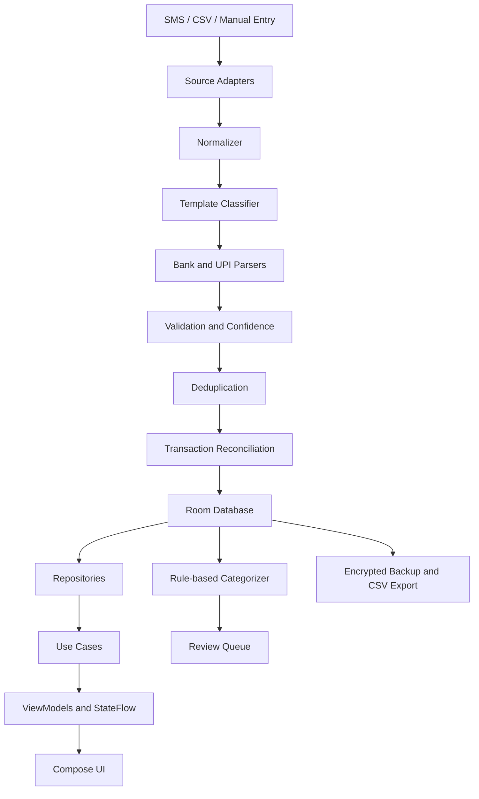
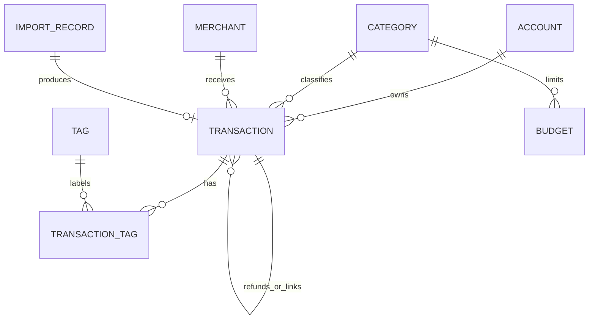

# Personal UPI Expense Tracker — Complete Development Plan

## 1. Executive decision

Build an **Android-first, offline-first personal finance app** that automatically discovers transaction SMS messages, converts them into structured draft transactions, and asks for confirmation only when confidence is low. The app will track expenses, income, account-to-account transfers, and refunds across UPI apps such as Google Pay, PhonePe, CRED, and HDFC PayZapp.

Use **native Kotlin, Jetpack Compose, Room, Coroutines/Flow, Hilt, WorkManager, and Android Keystore-backed security**. Do not build a backend for version 1. All financial data stays on the phone; backups are explicitly exported as encrypted files controlled by the owner.

The application is for personal sideloading rather than Play Store distribution. This is important because Android classifies `READ_SMS` and `RECEIVE_SMS` as dangerous, hard-restricted permissions, and Google Play strongly restricts SMS access.[cite:24][cite:51][cite:144] The design must therefore include a fallback import path—manual entry and bank-statement CSV import—even if direct SMS access works on the target phone.

---

## 2. Confirmed requirements

### 2.1 Product scope

Version 1 will support:

- Expense transactions.
- Income transactions.
- Transfers between owned accounts or wallets.
- Full and partial refunds.
- Automatic discovery from bank and UPI SMS messages.
- A review queue for imported transactions.
- Manual transaction entry and editing.
- Multiple banks, UPI apps, accounts, cards, and wallets.
- Categories, merchants, tags, notes, and attachments where needed.
- Monthly budgets and spending summaries.
- Search, filters, reports, and CSV export.
- Encrypted local backups and restore.
- Indian Rupees as the initial/default currency.
- Offline operation with no account registration and no server.

### 2.2 Explicit non-goals for version 1

- No bank-login scraping or screen scraping.
- No UPI PIN collection.
- No transaction initiation or payment functionality.
- No cloud backend, multi-user sharing, or web dashboard.
- No investment portfolio, tax filing, or credit-score tracking.
- No machine-learning model in the first release.
- No OCR receipt scanner until transaction capture is stable.
- No accessibility-service automation.
- No advertisements, analytics SDKs, or third-party trackers.

---

## 3. Recommended technology stack

| Layer | Selected technology | Rationale |
|---|---|---|
| Platform | Native Android | Best access to SMS, notifications, storage, biometric, backup, and lifecycle APIs |
| Language | Kotlin | First-class support for Compose, coroutines, sealed models, and modern Android APIs |
| UI | Jetpack Compose + Material 3 | Recommended modern Android UI toolkit; supports unidirectional data flow well[cite:58][cite:127] |
| Architecture | Feature-oriented Clean Architecture, MVVM, UDF | Clear boundaries without unnecessary microservice-style complexity |
| UI state | `ViewModel`, immutable `UiState`, `StateFlow` | Lifecycle-aware and testable; aligns with Android architecture guidance[cite:58][cite:132] |
| Local database | Room over SQLite | Compile-time SQL checking, migrations, transactions, DAO APIs, and Flow support[cite:119][cite:120] |
| Settings | Preferences DataStore | Appropriate for small settings; asynchronous and transactional[cite:108][cite:109] |
| Dependency injection | Hilt | Standardized object graph and test replacement |
| Async work | Kotlin Coroutines + Flow | Structured concurrency and reactive database queries |
| Persistent jobs | WorkManager | Reliable import/reconciliation/backup reminders across process and device restarts[cite:124] |
| Serialization | Kotlinx Serialization | Typed JSON for backup manifests and parser configuration |
| Date/time | `java.time` | Correct timezone-aware date handling on supported Android versions |
| Money | `Long` paise, never `Double` | Exact calculations without floating-point rounding errors |
| Charts | Compose-native chart library or small custom Canvas charts | Avoid a large dependency for basic monthly/category charts |
| Security | Android Keystore + AES-GCM/Tink; biometric gate | Non-exportable local keys and controlled access[cite:112][cite:117] |
| Backup encryption | AES-256-GCM with passphrase-derived key | Portable backup that can be restored on another device |
| Tests | JUnit, Kotest assertions, MockK/fakes, Turbine, Room in-memory tests, Compose UI tests | Covers domain, parser, persistence, and critical UI flows |
| Static quality | Detekt, Ktlint, Android Lint, dependency verification | Consistent code and safer dependencies |
| CI | GitHub Actions | Build, lint, unit test, instrumentation test, and release APK artifacts |

### 3.1 Why no backend

A backend adds authentication, hosting, network security, database maintenance, sync conflicts, and recurring cost without providing meaningful value for a single-device personal app. Room is the source of truth. Exported encrypted backup files provide portability and disaster recovery.

### 3.2 Why no cross-platform framework

The difficult parts are Android-specific: SMS access, `BroadcastReceiver`, notification access, background-work restrictions, biometric authentication, Keystore, and Android document APIs. Native Android avoids maintaining Kotlin bridges from Flutter or React Native.

---

## 4. Permission and distribution strategy

### 4.1 Personal distribution

Use a signed release APK distributed privately and installed directly. Keep the signing keystore backed up securely; future updates must be signed with the same key.

Direct SMS access is the largest feasibility risk. `READ_SMS` and `RECEIVE_SMS` are hard-restricted permissions, and users cannot always manually allowlist a hard-restricted permission; behavior depends on the installer and device software.[cite:24][cite:137][cite:144] Google Play additionally requires qualifying apps to follow its SMS permission policy, usually involving a default-handler role or an approved exception.[cite:51][cite:97][cite:145]

### 4.2 Build flavors

Create two product flavors:

| Flavor | Capture methods | Purpose |
|---|---|---|
| `personalSms` | SMS inbox scan, new-SMS receiver, manual entry, CSV | Private sideloaded build |
| `safe` | Manual entry, CSV, share-to-app; optional notification listener | Fallback build when SMS permissions are blocked |

Keep SMS-specific code behind an `SmsSource` interface so the rest of the application remains unchanged.

### 4.3 Minimum permissions

For the `personalSms` flavor only:

```xml
<uses-permission android:name="android.permission.READ_SMS" />
<uses-permission android:name="android.permission.RECEIVE_SMS" />
<uses-permission android:name="android.permission.POST_NOTIFICATIONS" />
<uses-permission android:name="android.permission.USE_BIOMETRIC" />
```

Do not request internet permission in version 1. Do not request contacts, location, call logs, accessibility, overlay, or broad storage permissions.

### 4.4 Progressive permission onboarding

1. Explain that the app reads transaction messages locally.
2. State that OTP and personal messages are ignored.
3. Explain what data is stored and whether raw SMS text is retained.
4. Request SMS permissions only after explicit opt-in.
5. If denied or unavailable, continue with manual and CSV import.
6. Allow permissions to be revoked without making existing records inaccessible.

---

## 5. High-level architecture



### 5.1 Application layers

- **Presentation:** Compose screens, reusable components, ViewModels, navigation.
- **Domain:** Models, use cases, money/date utilities, parsing contracts, categorization and reconciliation rules.
- **Data:** Room entities/DAOs, DataStore, Android SMS adapter, CSV adapter, repositories, backup implementation.
- **Platform:** Broadcast receivers, WorkManager workers, biometric prompt, Keystore, document picker, notifications.

Follow a single source of truth: the Room database owns persisted financial state. Repositories expose Flow streams, ViewModels transform them into immutable screen state, and UI events flow back to ViewModels.[cite:58][cite:127]

### 5.2 Module strategy

Start with one Gradle application module and feature-oriented packages. A single-person app does not need premature multi-module complexity. Extract Gradle modules only if build time or coupling becomes a measurable problem.

```text
com.personal.expensetracker
├── app
│   ├── ExpenseTrackerApp.kt
│   ├── MainActivity.kt
│   └── navigation/
├── core
│   ├── common/
│   ├── designsystem/
│   ├── money/
│   ├── time/
│   ├── security/
│   └── testing/
├── domain
│   ├── model/
│   ├── repository/
│   ├── usecase/
│   ├── parser/
│   ├── categorization/
│   └── reconciliation/
├── data
│   ├── db/
│   ├── datastore/
│   ├── sms/
│   ├── csv/
│   ├── backup/
│   └── repository/
├── feature
│   ├── onboarding/
│   ├── dashboard/
│   ├── transactions/
│   ├── review/
│   ├── addedit/
│   ├── accounts/
│   ├── budgets/
│   ├── reports/
│   ├── search/
│   ├── backuprestore/
│   └── settings/
└── worker/
```

---

## 6. Domain model

### 6.1 Transaction types

```kotlin
enum class TransactionType {
    EXPENSE,
    INCOME,
    TRANSFER,
    REFUND
}

enum class TransactionStatus {
    DRAFT,
    NEEDS_REVIEW,
    CONFIRMED,
    EXCLUDED,
    DELETED
}

enum class TransactionSource {
    SMS,
    CSV,
    MANUAL,
    NOTIFICATION,
    RESTORED_BACKUP
}
```

Use `Long` paise for all calculations. For example, ₹123.45 is stored as `12345`, not `123.45`. Store timestamps as epoch milliseconds plus the source timezone when needed. Display dates in `Asia/Kolkata` by default.

### 6.2 Core entities

#### `AccountEntity`

- `id: UUID/String`
- `name`
- `type`: bank, credit card, wallet, cash
- `institutionName`
- `maskedIdentifier`: last four digits only
- `openingBalancePaise`
- `currencyCode`
- `isOwned`
- `isActive`
- `createdAt`, `updatedAt`

#### `TransactionEntity`

- `id`
- `type`
- `status`
- `amountPaise`
- `currencyCode`
- `occurredAt`
- `accountId`
- `destinationAccountId` for transfers
- `merchantId`
- `categoryId`
- `counterpartyName`
- `description`
- `note`
- `paymentMethod`: UPI, card, wallet, cash, bank transfer
- `upiReference`
- `bankReference`
- `parentTransactionId` for refunds
- `source`
- `sourceRecordId`
- `confidenceScore`
- `isUserModified`
- `createdAt`, `updatedAt`

#### Supporting entities

- `CategoryEntity`: name, icon, color, parent category, expense/income applicability.
- `MerchantEntity`: canonical name, aliases, default category.
- `TagEntity` and `TransactionTagCrossRef`.
- `ImportRecordEntity`: source hash, sender, received time, parser version, outcome, redacted text or encrypted raw text.
- `CategorizationRuleEntity`: priority, match field, pattern, target category/merchant/account.
- `BudgetEntity`: month, category, limit in paise, rollover preference.
- `ReviewDecisionEntity`: before/after values to improve deterministic rules.
- `BackupHistoryEntity`: file metadata, schema version, checksum, result.

### 6.3 Relationships



### 6.4 Essential indexes

- Unique index on normalized `sourceHash`.
- Unique partial/business constraint for non-null UPI/bank reference plus amount/account/date window.
- Index on `occurredAt DESC`.
- Composite index on `(accountId, occurredAt)`.
- Composite index on `(categoryId, occurredAt)`.
- Index on normalized merchant/counterparty.
- Index on transaction status for the review queue.

Use Room migrations from the first release. Never use destructive migration for personal finance data.

---

## 7. SMS ingestion design

### 7.1 Sources

- Initial historical scan of SMS inbox after permission is granted.
- `BroadcastReceiver` for newly received SMS.
- User-triggered rescan for a date range.
- Fallback CSV import from bank or card statements.
- Manual entry for cash and missing transactions.

### 7.2 Processing pipeline

1. Read sender, timestamp, and body.
2. Normalize Unicode, whitespace, currency symbols, and masked account patterns.
3. Reject OTP, promotional, balance-only, login, and verification messages.
4. Detect probable financial direction: debit, credit, refund, failed, reversed.
5. Select parser using sender ID and message fingerprints.
6. Extract amount, account suffix, merchant/payee, timestamp, UPI reference, bank reference, and channel.
7. Validate amount and mandatory fields.
8. Compute a confidence score.
9. Generate a stable source hash.
10. Deduplicate against previous imports and confirmed transactions.
11. Match or create an account.
12. Classify expense, income, transfer, or refund.
13. Apply merchant normalization and categorization rules.
14. Auto-confirm only above the configured threshold; otherwise place in review.
15. Record parser version and result for debugging.

### 7.3 Parser contract

```kotlin
interface TransactionMessageParser {
    val id: String
    val version: Int

    fun supports(message: NormalizedMessage): Boolean
    fun parse(message: NormalizedMessage): ParseResult
}

data class ParseCandidate(
    val direction: MoneyDirection,
    val amountPaise: Long,
    val accountSuffix: String?,
    val counterparty: String?,
    val occurredAt: Instant,
    val upiReference: String?,
    val bankReference: String?,
    val channel: PaymentMethod,
    val confidence: Double
)
```

Create template families instead of one giant regular expression:

- Bank debit SMS.
- Bank credit SMS.
- UPI sent/paid SMS.
- UPI received SMS.
- Credit-card purchase SMS.
- Wallet debit/credit SMS.
- Refund/reversal SMS.
- Failed transaction SMS.

Add a parser per institution/template only when a fixture exists. Keep all real test fixtures redacted.

### 7.4 Confidence scoring

Example scoring model:

| Signal | Score effect |
|---|---:|
| Recognized bank sender | +0.15 |
| Debit/credit keyword confidently found | +0.20 |
| Valid amount extracted | +0.25 |
| Account suffix extracted | +0.10 |
| UPI/bank reference extracted | +0.15 |
| Merchant/payee extracted | +0.10 |
| Transaction timestamp valid | +0.05 |
| OTP/promotional/failed keyword | Reject or strong penalty |
| Ambiguous two amounts | -0.25 |

Recommended behavior:

- `>= 0.90`: auto-confirm if deduplication is also certain.
- `0.65–0.89`: add to review queue with suggested fields.
- `< 0.65`: keep as rejected import log; allow manual conversion.

Make thresholds configurable after observing real messages.

### 7.5 Deduplication

Use layered checks:

1. Exact hash of normalized sender + normalized message + received timestamp bucket.
2. Exact UPI reference or bank reference when available.
3. Same account + amount + direction + merchant within a short time window.
4. Compare CSV imports against previously imported SMS transactions.
5. Never silently merge ambiguous matches; show them in a duplicate-resolution screen.

### 7.6 Raw SMS retention

Default recommendation:

- Store the source SMS system ID and a SHA-256 source hash.
- Store a short redacted excerpt for debugging.
- Do not store OTPs or unrelated messages.
- If full raw text is needed for parser improvement, encrypt it and offer a “delete raw messages after confirmation” setting.
- Deleting an imported financial record must not delete the user’s SMS from the system inbox.

---

## 8. Transaction semantics

### 8.1 Expenses and income

A debit to a merchant is normally an expense. A salary/payment credit is normally income. However, direction alone is insufficient—cash withdrawals and owned-account transfers must not inflate spending.

### 8.2 Transfers

Support:

- Bank account to wallet.
- Bank account to another owned bank account.
- Credit-card bill payment.
- Cash withdrawal as transfer from bank to cash account.
- Cash deposit as transfer from cash to bank.

Represent a transfer as one logical transaction with source and destination accounts, or as a linked double-entry pair internally. Prefer a logical transfer with two account impacts produced by a balance ledger service; this avoids duplicate user-visible rows while preserving correct balances.

### 8.3 Refunds

A refund should link to the original expense when possible. It must reduce net spending in the original category without being counted as ordinary income. Support partial refunds and refunds received in a later month.

### 8.4 Failed and reversed transactions

- Failed transactions: record in import history but do not create confirmed spending.
- Reversal with matching original: mark/reconcile the original and attach reversal.
- Reversal without original: place in review.

---

## 9. Categorization strategy

### 9.1 Initial categories

- Food & dining
- Groceries
- Transport
- Rent & housing
- Utilities
- Mobile & internet recharge
- Entertainment
- Shopping
- Healthcare & medicines
- Education
- Family support
- Charity & gifts
- Subscriptions
- Travel
- Personal care
- Fees & charges
- Cash withdrawal
- Loans given/received
- Salary & income
- Refunds
- Transfers
- Uncategorized

### 9.2 Deterministic rule engine

Rules run in priority order:

1. Exact merchant alias.
2. UPI ID/payee match.
3. Description contains keyword.
4. Sender/institution plus transaction channel.
5. Amount/account/time recurring pattern.
6. User’s prior confirmed merchant category.
7. Fallback to Uncategorized.

A rule should be created only after user confirmation, such as “Always categorize `TSRTC` as Transport.” Store normalized merchant aliases separately so corrections improve future imports without an ML model.

### 9.3 Optional later intelligence

After enough confirmed records exist, add an on-device classifier using features such as normalized merchant tokens, transaction channel, amount band, weekday, and recurrence. It must remain optional, explain its suggestion, and never upload transaction data.

---

## 10. Screens and user flows

### 10.1 Navigation

Use a bottom bar with:

- Home
- Transactions
- Add
- Budgets
- Reports

Place Accounts, Import, Backup, Categories, Rules, and Settings under a menu/settings destination.

### 10.2 Onboarding

1. Explain offline/private design.
2. Choose currency and month start day.
3. Create primary bank/wallet/cash accounts.
4. Explain SMS processing.
5. Request SMS permission or choose fallback import.
6. Select historical scan range.
7. Review detected accounts.
8. Review first transaction batch.
9. Configure biometric lock and backup reminder.

### 10.3 Dashboard

Show:

- Current-month expenses.
- Current-month income.
- Net cash flow.
- Budget used percentage.
- Transactions needing review.
- Spending by top categories.
- Recent transactions.
- Quick actions: add expense, add income, scan/import, review drafts.

Avoid showing a misleading account “balance” unless opening balances and every transfer are reliably tracked.

### 10.4 Review queue

Each card shows:

- Parsed amount and debit/credit direction.
- Detected account.
- Merchant/payee.
- Suggested type and category.
- Date/time.
- Confidence and reason for review.
- Redacted source excerpt.

Actions:

- Confirm.
- Edit then confirm.
- Mark as transfer.
- Link as refund.
- Exclude.
- Merge duplicate.
- Create categorization rule.

Support batch confirmation only for high-confidence, same-template records.

### 10.5 Transactions

- Group by date.
- Search merchant, note, reference, amount, or category.
- Filter by date range, account, category, type, status, source, tag, and amount range.
- Swipe actions should be non-destructive.
- Deletion goes to a recoverable trash state before permanent purge.

### 10.6 Add/edit transaction

Fields:

- Type.
- Amount.
- Date/time.
- Account and destination account.
- Merchant/payee.
- Category.
- Payment method.
- Notes and tags.
- Link to original transaction for refund.
- Recurring marker where appropriate.

### 10.7 Budgets

- Overall monthly budget.
- Per-category monthly budgets.
- Warning at configurable percentages.
- Carryover disabled initially to keep calculations understandable.
- Exclude transfers; subtract refunds from applicable spending.

### 10.8 Reports

Version 1 reports:

- Monthly income, expense, and net cash flow.
- Category breakdown.
- Merchant breakdown.
- Daily/weekly spending trend.
- Account/payment-method breakdown.
- Budget versus actual.
- Month-over-month comparison.
- Refund and fee summary.

All report queries should be aggregate SQL in DAOs, not full-table loading and Kotlin-side aggregation.

---

## 11. Backup, restore, and export

### 11.1 Backup format

Create one encrypted portable file, for example:

```text
expense-backup-2026-10-03.petbackup
```

Logical content before encryption:

```text
manifest.json
transactions.jsonl
accounts.json
categories.json
merchants.json
rules.json
budgets.json
settings.json
checksums.json
```

Manifest fields:

- Backup format version.
- Database schema version.
- App version.
- Created timestamp.
- Currency.
- Record counts.
- Encryption/KDF metadata.
- Content checksums.

Encrypt the complete archive using AES-256-GCM. Derive the portable key from a user-entered backup passphrase using a strong KDF with a unique random salt. Do not use only the Android Keystore for portable backups because Keystore keys are intentionally non-exportable and device-bound.[cite:117]

### 11.2 Local database security

- Store the database in app-private internal storage; Android’s sandbox prevents ordinary apps from reading it.[cite:112]
- Protect highly sensitive fields with application-level encryption if raw message text is retained.
- Keep encryption keys in Android Keystore.
- Offer biometric/PIN gating when opening the app.
- Disable screenshots on sensitive screens as an optional setting.
- Redact transaction details in recent-app previews and notifications.

### 11.3 Backup policy

- Manual encrypted export through Android’s Storage Access Framework.
- Optional weekly reminder—not automatic unencrypted export.
- Keep the last successful backup date on the dashboard/settings.
- Verify a backup immediately after writing it.
- Test restore into a temporary database before replacing live data.
- Make restore atomic: either complete successfully or leave the existing database untouched.

Although Android Auto Backup can encrypt backups at rest and in transit, this project should disable/default-exclude the finance database and use explicit encrypted export for predictable control.[cite:123][cite:125]

### 11.4 CSV export

Export confirmed transactions using columns:

```text
id,date,time,type,amount,currency,account,destination_account,
merchant,category,payment_method,status,upi_reference,bank_reference,
tags,note,source
```

Escape CSV correctly and use UTF-8. Exports are plaintext, so display a privacy warning before saving or sharing.

---

## 12. Performance plan

- Use paged transaction queries for long history.
- Add indexes before optimizing code-level loops.
- Keep SMS parsing and imports off the main thread.
- Use database transactions for each import batch.
- Avoid waking the application repeatedly; process new SMS quickly and defer reconciliation when appropriate.
- Use unique WorkManager jobs to prevent duplicate scans.[cite:124][cite:126]
- Cache only display-ready category/merchant metadata, not complete transaction lists.
- Use immutable UI models and stable keys in lazy lists.
- Measure startup, transaction-list scrolling, monthly aggregation, and large import performance.

Initial targets for the target phone:

- Cold startup under 1.5 seconds when the database is already initialized.
- Dashboard query under 300 ms for five years of personal data.
- Transaction list maintains smooth scrolling.
- Import of 10,000 candidate SMS messages completes without UI blocking or out-of-memory errors.
- Reopening the app does not rerun a complete inbox scan.

These are engineering acceptance targets, not claims about guaranteed device performance.

---

## 13. Error handling and observability

Because no analytics backend exists, create an on-device diagnostic log containing:

- Parser ID/version.
- Import batch ID.
- Counts: scanned, ignored, parsed, duplicate, review, failed.
- Sanitized exception type and stack trace.
- Database migration and backup/restore results.

Never log full SMS bodies, UPI IDs, account numbers, notes, or transaction references in release builds. Provide “Export diagnostic log” with redaction for debugging.

Use typed failures:

```kotlin
sealed interface ImportFailure {
    data object PermissionDenied : ImportFailure
    data object SmsAccessRestricted : ImportFailure
    data class UnsupportedTemplate(val fingerprint: String) : ImportFailure
    data class InvalidAmount(val redactedInput: String) : ImportFailure
    data class DatabaseFailure(val causeCode: String) : ImportFailure
}
```

---

## 14. Testing strategy

### 14.1 Unit tests

- Money parsing and formatting.
- Every SMS template parser.
- OTP/promotional/failed-message rejection.
- Confidence scoring.
- Source hash stability.
- Deduplication.
- Transfer matching.
- Refund linking and net-spend calculations.
- Categorization rules and priority.
- Budget calculations.
- Monthly date boundaries and timezone behavior.
- Backup encryption/decryption and wrong-passphrase handling.

### 14.2 Parser fixtures

Maintain a redacted fixture corpus:

```text
fixtures/
├── hdfc/
│   ├── debit_upi_01.txt
│   ├── credit_upi_01.txt
│   └── refund_01.txt
├── card/
├── wallet/
├── negative/
│   ├── otp.txt
│   ├── promotional.txt
│   └── failed_transaction.txt
└── expected/
```

Every new unsupported message template first becomes a failing test, then receives a parser change. This prevents fixing one bank template while breaking another.

### 14.3 Database tests

- DAO CRUD and aggregate queries.
- Unique constraints and duplicate handling.
- Multi-step transaction atomicity.
- Migrations from every released schema version.
- Restore into temporary database.
- Large synthetic structure tests may be used for performance mechanics, but financial behavior fixtures must stay deterministic and clearly non-production.

### 14.4 UI tests

Critical flows:

- Onboarding with SMS denied.
- Onboarding with SMS granted.
- Review and confirm transaction.
- Mark expense as transfer.
- Link refund.
- Create/edit budget.
- Search and filters.
- Export backup, restore backup, wrong password, corrupted file.
- Biometric unavailable/failure fallback.

### 14.5 Device testing

Primary device: iQOO Z7s. Also test at least one emulator/current Android version and one older supported API. Validate Funtouch OS background restrictions, permission behavior, receiver delivery, battery settings, and document picker behavior.

---

## 15. Development phases

### Phase 0 — Discovery and fixtures

**Goal:** Remove SMS feasibility and transaction-model uncertainty before building polished UI.

Tasks:

- Create a new Kotlin/Compose project.
- Record the target phone’s Android/Funtouch OS version.
- Test whether the private build can obtain `READ_SMS` and `RECEIVE_SMS`.
- Collect and redact sample transaction SMS messages for each used bank/app flow.
- Identify account/card suffixes and transaction variants.
- Finalize transaction semantics and categories.
- Write parser fixtures and expected outputs.

Exit criteria:

- SMS permission behavior is known.
- At least 30–50 varied, redacted message fixtures exist.
- Expense, income, transfer, refund, reversal, and failed-message behavior is documented.

### Phase 1 — Foundation

Tasks:

- Configure Gradle version catalog.
- Add Compose, Navigation, Room, Hilt, Coroutines, DataStore, WorkManager, serialization, and tests.
- Establish theme and design system.
- Implement money/date primitives.
- Create Room schema, DAOs, migrations, repositories, and test database.
- Add app navigation and empty screen shells.
- Add Detekt, Ktlint, CI, and release signing configuration placeholders.

Exit criteria:

- App builds in debug/release.
- CI passes lint and unit tests.
- Manual transaction CRUD persists after restart.

### Phase 2 — Manual tracker MVP

Tasks:

- Account management.
- Category management.
- Add/edit expense, income, transfer, refund.
- Transaction list, details, search, and filters.
- Dashboard monthly aggregates.
- Basic budgets and reports.

Exit criteria:

- App is already usable without SMS access.
- Transfer and refund calculations are correct.
- All money remains exact in paise.

### Phase 3 — SMS import

Tasks:

- Permission onboarding.
- Historical inbox scanner.
- New SMS receiver.
- Normalizer and rejection filters.
- Parser registry and initial parser families.
- Confidence scoring and import records.
- Deduplication.
- Review queue.
- Import diagnostics.

Exit criteria:

- Known fixtures parse correctly.
- OTP and promotional messages never produce transactions.
- Rerunning a scan creates no duplicates.
- Low-confidence messages require review.

### Phase 4 — Reconciliation and categorization

Tasks:

- Account suffix mapping.
- Merchant normalization and aliases.
- User-created categorization rules.
- Transfer pair detection.
- Refund/reversal linking.
- CSV import and SMS/CSV cross-deduplication.

Exit criteria:

- Owned-account transfers do not count as spending or income.
- Refunds reduce net category spending.
- Merchant corrections apply to future imports.

### Phase 5 — Security and recovery

Tasks:

- Biometric lock.
- Sensitive screen redaction.
- Keystore key management.
- Encrypted backup format.
- Atomic restore with validation.
- CSV export.
- Backup reminders and history.

Exit criteria:

- Backup restores onto a clean installation using the passphrase.
- Wrong password and corrupt files fail safely.
- Existing data remains intact after failed restore.

### Phase 6 — Hardening

Tasks:

- Migration tests.
- Large-history performance tests.
- Compose UI tests.
- Battery/background behavior on iQOO.
- Parser fuzz/edge-case testing.
- Release build shrinking and obfuscation.
- Private privacy statement and recovery documentation.

Exit criteria:

- No critical lint/security findings.
- No known duplicate or money-rounding defects.
- Release APK can update an existing installation without data loss.

---

## 16. Suggested implementation order

Use this exact order to reduce rework:

1. Money and time primitives.
2. Transaction/account/category domain models.
3. Room schema, DAOs, migrations, and repositories.
4. Manual transaction entry.
5. Transaction list/search.
6. Correct transfer and refund semantics.
7. Dashboard aggregates.
8. SMS feasibility spike.
9. Fixture-based parser engine.
10. Import records and deduplication.
11. Review queue.
12. Merchant/category rules.
13. Budgets and reports.
14. Backup/restore.
15. Security lock and privacy polish.
16. CSV import/export.
17. Performance and release hardening.

Do not start with charts, animations, or AI categorization. Correct transaction ingestion, deduplication, transfers, and recoverability are the highest-risk and highest-value areas.

---

## 17. Definition of done

A feature is complete only when:

- Its user flow works after process death and device restart where applicable.
- Business logic has unit tests.
- Database changes include a migration test.
- Loading, empty, error, and permission-denied states exist.
- Sensitive data is absent from logs.
- Accessibility labels and touch sizes are acceptable.
- No work runs unnecessarily on the main thread.
- The feature works without network connectivity.
- Backup/restore compatibility is considered for schema changes.

Release 1 is ready when:

- Expenses, income, transfers, and refunds are correct.
- Automatic import works for the owner’s actual message templates or has a dependable fallback.
- Duplicate scans are idempotent.
- Every automatic transaction can be traced to its source and edited.
- Reports exclude transfers and net refunds correctly.
- Data can be encrypted, backed up, restored, and exported.
- The signed APK updates without deleting existing data.

---

## 18. Risks and mitigations

| Risk | Impact | Mitigation |
|---|---|---|
| iQOO/Android blocks SMS permission | Automatic import unavailable | Validate first; maintain safe flavor, CSV/manual fallback, optional notification adapter |
| Bank changes SMS template | Parsing fails or becomes inaccurate | Parser registry, versioned fixtures, review queue, unsupported-template diagnostics |
| Duplicate SMS and CSV records | Inflated spending | Source hashes, reference IDs, fuzzy matching, manual duplicate resolver |
| Transfer classified as expense | Incorrect reports | Owned-account mapping, transfer matcher, explicit review action |
| Refund treated as income | Incorrect cash-flow/category analytics | Refund type linked to parent expense |
| Lost phone | Data loss | Encrypted portable backup reminders and tested restore |
| Forgotten backup password | Backup unrecoverable | Prominent warning and restore verification; no insecure password bypass |
| Database schema bug | Data loss | Explicit migrations, migration tests, pre-migration backup |
| Sensitive text in logs/exports | Privacy exposure | Redaction, no analytics SDK, export warnings, encrypted backup |
| Overengineering | Project stalls | Single app module, deterministic rules, no backend, phased delivery |

---

## 19. First implementation milestone

The first milestone should be a **manual offline tracker with the final transaction model**, not an SMS demo. Deliver:

- Account setup.
- Expense/income/transfer/refund entry.
- Transaction list and details.
- Monthly totals.
- Room migrations.
- Unit tests for money, transfers, and refunds.

In parallel, create a small SMS feasibility branch that only requests permission, scans a bounded date range, and exports a sanitized parser diagnostic. Merge SMS functionality only after permission behavior and sample templates are proven on the target iQOO device.

This sequence ensures the application remains useful even if Android prevents direct SMS access and avoids redesigning the database after automatic import begins.
